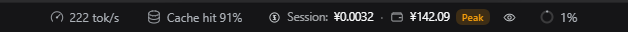
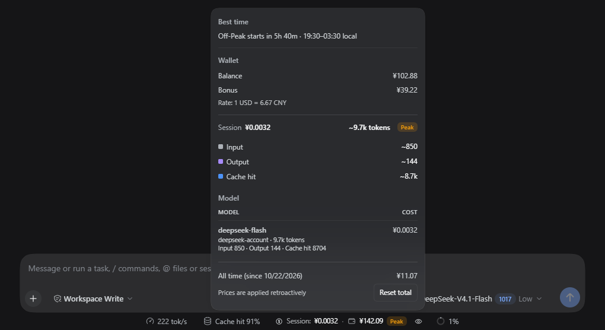
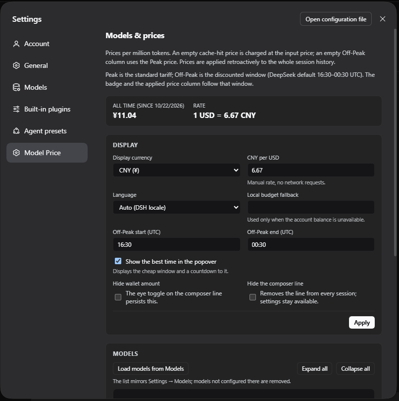
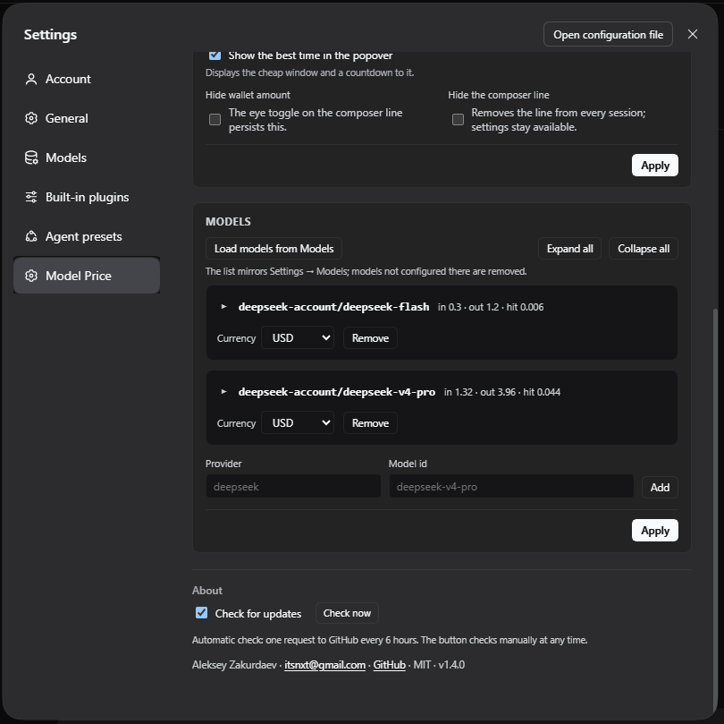

# dsh-model-price — цены API для DeepSeek Harness

[English](README.md) | **Русский** | [Сайт](https://itsbuyru-bit.github.io/dsh-model-price/ru/)

[](https://github.com/itsbuyru-bit/dsh-model-price/actions/workflows/ci.yml)
[](LICENSE)
[](#требования)
[](#поддерживаемые-версии)
[](#языки)

Цены за API по моделям, баланс кошелька и живой расход сессии для
**DeepSeek Harness**. Плагин добавляет компактную строку под окном ввода —
`Сессия: $0.0123 · Кошелёк: $12.34 · Peak` — и секцию **Модели и цены** в
настройках, где задаётся стоимость каждого миллиона токенов в USD или CNY
отдельно для Peak и Off-Peak.

Плагин — это Host + Client бандл. Он не патчит Harness, не меняет журнал
сессий и хранит все свои данные в `~/.dsh/api-spend/`.

> **Неофициальный проект.** Он не связан с DeepSeek, не одобрен и не
> спонсируется компанией DeepSeek. «DeepSeek» и «DeepSeek Harness» принадлежат
> их авторам. См. [Неаффилированность](#неаффилированность).

---

## Скриншоты

<p align="center">
  <a href="docs/images/composer-line.png"></a>
</p>

<p align="center">
  <a href="docs/images/popover.png"></a>
</p>

| Настройки — Display | Настройки — Models |
|:---:|:---:|
| <a href="docs/images/settings-display.png"></a> | <a href="docs/images/settings-models.png"></a> |

---

## Содержание

- [Скриншоты](#скриншоты)
- [Что делает плагин](#что-делает-плагин)
- [Возможности](#возможности)
- [Поддерживаемые версии](#поддерживаемые-версии)
- [Требования](#требования)
- [Быстрый старт](#быстрый-старт)
- [Использование](#использование)
- [Как это работает](#как-это-работает)
- [Модель цен](#модель-цен)
- [Языки](#языки)
- [Данные и приватность](#данные-и-приватность)
- [Структура проекта](#структура-проекта)
- [Тестирование](#тестирование)
- [Обновление](#обновление)
- [Перенос на другой компьютер](#перенос-на-другой-компьютер)
- [Решение проблем](#решение-проблем)
- [Ограничения](#ограничения)
- [Участие](#участие)
- [Безопасность](#безопасность)
- [Лицензия и благодарности](#лицензия-и-благодарности)
- [Неаффилированность](#неаффилированность)

---

## Что делает плагин

DeepSeek Harness показывает расход токенов по шагам, но не умеет считать деньги
по моделям и не показывает кошелёк. Плагин добавляет и то, и другое:

| Поверхность | Что показывает | Где живёт |
|---|---|---|
| Строка под вводом | Расход сессии, баланс, бейдж Peak / Off-Peak, индикатор работы | `conversation.composer.dock`, order 2 |
| Поповер | Состав токенов, стоимость по моделям, разбивка кошелька, дочерние сессии, общий итог | Клик по строке |
| Секция настроек | Таблица цен, валюта, ручной курс, окно Off-Peak, язык | `settings.section`, order 30 |
| Host API | Цены, кошелёк, агрегация сессии | `/api-spend/api/*` |

Плагин работает от журнала сессии: сворачивает usage из `assistant/message` в
проекцию и считает деньги при чтении. Он не оценивает токены «на глаз», не
переписывает логи и не блокирует запросы.

---

## Возможности

- **Таблица цен по моделям** — ввод (cache miss), вывод, кэш-хит и запись
  кэша, каждая с ценой Peak и Off-Peak.
- **Две валюты** — цены в USD или CNY, отображение в одной валюте, конвертация
  по ручному курсу из настроек.
- **Кошелёк** — реальный баланс аккаунта DeepSeek и бонусные кошельки; если
  аккаунт недоступен, работает локальный бюджет.
- **Живой расход сессии** — обновляется во время работы модели, повторы не
  задваиваются, шаги без usage показываются, а не додумываются.
- **Peak / Off-Peak** — редактируемое окно в UTC, оранжевый Peak, зелёный
  Off-Peak, для каждого шага берётся цена нужной колонки.
- **Синхронизация моделей** — одна кнопка повторяет список моделей, привязанных
  в **Настройки → Models**. Провайдер с пустым списком не даёт ничего, а модели,
  убранные из Models, исчезают из таблицы цен вместе со своими ценами.
- **Локализация** — 9 языков и автоматическое обнаружение новых файлов.
- **Лучшее время** — поповер показывает окно Off-Peak по местному времени и
  обратный отсчёт до его начала (или до конца, если оно уже идёт).
- **Индикатор обновлений** — необязательная проверка последнего релиза GitHub
  (не чаще раза в 6 часов), кнопка **Проверить сейчас** и ссылка на новый релиз
  в блоке «О плагине».
- **Без зависимостей и сборки** — обычный JavaScript.

---

## Поддерживаемые версии

| Компонент | Значение |
|---|---|
| DeepSeek Harness | **0.2.x** — проверено на **0.2.1-rc.2** (Desktop, Windows) |
| Профиль | `desktop` (Web/Desktop); любой профиль с Web UI |
| Node.js | встроенный в DSH, **22.5+** |
| Версия плагина | **1.4.1** |

Жёсткой привязки к версии нет. Если в будущем переименуют слот, ключ проекции
или сервис, соответствующая часть просто не отрисуется — страница не упадёт, а
Host API продолжит работать.

---

## Требования

| Нужно | Зачем |
|---|---|
| **DeepSeek Harness 0.2.x** | Даёт Web UI, проекции сессий и сервис аккаунта |
| **Профиль Web/Desktop** | Строка и секция настроек — это слоты Web UI |
| **Аккаунт DeepSeek (опционально)** | Только для баланса; без него есть локальный бюджет |
| **Сборка не нужна** | `index.js` и `client.js` поставляются как есть |

Работает на Windows, macOS и Linux; интерфейс использует токены темы Harness и
подстраивается под светлую и тёмную тему.

---

## Быстрый старт

### Вариант 1 — Add Plugin (рекомендуется)

1. Откройте **Настройки → Плагины → Add plugin**.
2. Вставьте один из вариантов:

   ```
   github:itsbuyru-bit/dsh-model-price
   ```

   ```
   https://github.com/itsbuyru-bit/dsh-model-price
   ```

   ```
   /path/to/dsh-model-price
   ```

3. Установите, перезапустите DeepSeek Harness и обновите страницу.

Плагин распространяется только через GitHub; пакета в npm нет.

### Вариант 2 — CLI

```sh
dsh plugin --profile <your-profile> add github:itsbuyru-bit/dsh-model-price
```

Профиль `desktop` принадлежит Electron-приложению, и CLI отказывается в него
писать — для него используйте **Add Plugin** в интерфейсе.

### Вариант 3 — локальная разработка

```sh
git clone https://github.com/itsbuyru-bit/dsh-model-price.git
dsh plugin --profile <your-profile> add link:/absolute/path/to/dsh-model-price
```

Изменения Host-половины требуют переустановки бандла, клиентской — только
обновления страницы.

---

## Использование

1. Откройте **Настройки → Модели и цены**.
2. Нажмите **Загрузить модели из Models**, чтобы подтянуть модели из харнесса,
   или добавьте модель вручную (провайдер + id).
3. Разверните строку модели и заполните цены Peak / Off-Peak за 1M токенов.
4. Нажмите **Применить** внизу блока.

Строка показывает `Сессия: … · Кошелёк: … · Peak`. По клику — состав токенов,
стоимость по моделям, разбивка кошелька и общий итог; иконка глаза скрывает
кошелёк.

| Действие | Результат |
|---|---|
| Клик по строке | Открывает поповер расхода |
| Иконка глаза | Скрывает/показывает сумму кошелька (сохраняется) |
| **Загрузить модели из Models** | Повторяет привязанные в Models модели; лишние строки удаляются |
| **Развернуть все / Свернуть все** | Открывает или закрывает все строки цен |
| **Применить** (Display) | Сохраняет валюту, курс, окно, язык и переключатели |
| **Применить** (Models) | Сохраняет таблицу цен |
| **Сбросить итог** | Сбрасывает общий счётчик; история сессий остаётся |

Цены применяются ретроактивно: правка ставки пересчитывает видимую историю, о
чём поповер и сообщает. Модель без цены показывает `?` и попадает в список
«цена не задана», а не считается молчаливым нулём.

---

## Как это работает

### Host-половина — `index.js`

1. Регистрирует проекцию `modelPrice` с ключом `provider/model` и разбивкой на
   Peak / Off-Peak.
2. Сворачивает только `assistant/message`; повтор шага с тем же `turn/step`
   заменяет предыдущий замер, а не суммируется.
3. Ведёт общий счётчик в `totals.json`, обновляя его из `session/event`.
4. Считает деньги при чтении по текущей таблице и конвертирует в валюту
   отображения.
5. Берёт кошелёк из `deepseekAccount.getBalance` (кэш 45 секунд) и откатывается
   на локальный бюджет.
6. Отдаёт `/api-spend/api/{state,config,save,wallet,reset,catalog,locales}`.

### Клиентская половина — `client.js`

1. Регистрирует `conversation.composer.dock → spend` и
   `settings.section → model-price`.
2. Опрашивает состояние Host раз в 1–2,5 с (чаще во время хода) и рисует
   строку, поповер через портал и форму настроек.
3. Загружает локали из `/api-spend/api/locales`, поэтому язык плагина не
   зависит от языка Harness и переопределяется отдельно.

### Что считается

| Bucket | Источник | По какой цене |
|---|---|---|
| Input (cache miss) | `usage.inputTokens` | input |
| Cache read | `usage.cacheReadTokens` | cache hit, иначе input |
| Cache write | `usage.cacheWriteTokens` | cache write, пусто = бесплатно |
| Output | `usage.outputTokens` | output |

`reasoningTokens` уже входит в `outputTokens` и второй раз не тарифицируется.
Дочерние сессии учитываются, пока живы, и показываются отдельной строкой.

---

## Модель цен

| Правило | Поведение |
|---|---|
| Пустой cache hit | Считается по цене input |
| Пустой cache write | Бесплатно |
| Пустой Off-Peak | Берётся цена Peak |
| Нет цены input или output | Модель без цены, итог сессии показывает `?` |
| Валюта цены ≠ валюта отображения | Конвертация по ручному курсу |
| Окно Off-Peak | Редактируется в UTC, по умолчанию у DeepSeek 16:30–00:30 |
| Правка цен | Пересчитывает видимую историю (ретроактивно) |
| Бюджет | Только запасное отображение; лимитов и блокировок нет |

---

## Языки

Локали — файлы BCP 47 с субтегом региона или письменности:

| Файл | Язык |
|---|---|
| `locale/en-US.json` | English (US) |
| `locale/ru-RU.json` | Русский |
| `locale/zh-CN.json` | 简体中文 |
| `locale/ja-JP.json` | 日本語 |
| `locale/ko-KR.json` | 한국어 |
| `locale/es-ES.json` | Español |
| `locale/pt-BR.json` | Português (Brasil) |
| `locale/de-DE.json` | Deutsch |
| `locale/fr-FR.json` | Français |

### Как добавить язык

1. Скопируйте `locale/en-US.json` в `locale/<tag>.json`, где `<tag>` содержит
   субтег региона или письменности (`it-IT`, `nl-NL`, `tr-TR`, `zh-TW`). Файл
   без субтега (`en.json`) игнорируется.
2. Переведите все значения в `strings` и `meta.description`.
3. Сохраните ключи и подстановки `{n}` / `{rate}`; не переводите `Peak`,
   `Off-Peak`, `USD`, `CNY`, `DSH`, `DeepSeek`, `API`, `cache miss/hit/write` и
   `Model Price` (имя в инвентаре).
4. Переведите `settingsTitle` / `settingsNav` — это заголовок страницы и
   подпись в навигации.
5. Укажите `"locale"` тем же тегом, что имя файла, а `"name"` — название языка
   на нём самом.

Host перечитывает `locale/` при каждом запросе: положите файл и откройте
**Настройки → Модели и цены** (секция делает ре-скан) или обновите страницу.
Отсутствующие ключи берутся из `en-US`, затем показывается имя ключа.

Полный гайд: [docs/TRANSLATION.md](docs/TRANSLATION.md).

---

## Данные и приватность

| Данные | Где | Примечание |
|---|---|---|
| Цены, валюта, курс, окно, язык | `~/.dsh/api-spend/config.json` | Обычный JSON |
| Общие счётчики токенов | `~/.dsh/api-spend/totals.json` | Только bucket'ы токенов |
| Баланс кошелька | API аккаунта DeepSeek | Кэш 45 с в памяти, на диск не пишется |
| Расход сессии | Журнал сессии Harness | Читается проекцией, не изменяется |
| Проверка обновлений | GitHub Releases API | Необязательно; один запрос в 6 ч без payload |

Ни аналитики, ни телеметрии. Наружу уходят только обращение к балансу (его и
так делает Harness) и необязательная проверка обновлений; её можно выключить в
**Настройки → Модели и цены → О плагине → Проверять обновления**. Курс валют
вводится вручную.

---

## Сайт проекта

Статическая страница лежит в [`site/`](site/): тёмный hero, скриншоты, блок
возможностей, команда установки и переключатель RU/EN. Публикуется через
GitHub Pages:

**https://itsbuyru-bit.github.io/dsh-model-price/**

Деплой идёт через `.github/workflows/pages.yml`; включите один раз
**Settings → Pages → Source → GitHub Actions**, после чего каждый push в `main`
публикует `site/`.

---

## Структура проекта

```text
dsh-model-price/
├── index.js                 # Host: проекция, кошелёк, API цен
├── client.js                # Client: строка, поповер, настройки
├── lib/pricing.js           # Чистые функции цен (с тестами, в пакете)
├── cordis.patch.yml         # Вставляет строку плагина
├── icon.svg                 # Иконка плагина
├── locale/                  # 9 файлов BCP 47 (по 97 ключей)
├── test/pricing.test.mjs    # Юнит-тесты node:test
├── docs/                    # Архитектура, гайд по переводу, картинки
├── site/                    # Статический сайт (GitHub Pages)
├── migrate.ps1 / migrate.cmd # Экспорт/импорт рабочей папки между ПК
├── scripts/check.mjs        # Манифест, синтаксис и паритет локалей
├── .github/workflows/       # ci.yml, pages.yml, release.yml
├── README.md                # Английский
├── README.ru.md             # Русский
├── CHANGELOG.md
├── CONTRIBUTING.md
├── CODE_OF_CONDUCT.md
├── SECURITY.md
├── SUPPORT.md
├── LICENSE
└── package.json
```

---

## Тестирование

```sh
node scripts/check.mjs
node --test test/pricing.test.mjs
```

Проверка валидирует манифест, запускает `node --check` для Host, Client и
`lib/pricing.js`, сверяет каждую локаль с `en-US.json`: тег файла, поле
`locale`, набор ключей, пустые значения и сохранность `{placeholder}`.

Юнит-тесты покрывают чистый слой цен: стоимость за миллион токенов, фолбэки
cache-hit и cache-write, математику окна Off-Peak (включая переход через
полночь UTC), конвертацию валют, сравнение релизов и извлечение списка моделей,
привязанных в **Настройки → Models**. CI запускает обе команды на каждый push и
pull request.

---

## Обновление

- Распространение только через GitHub. Повторная установка бандла из
  `github:itsbuyru-bit/dsh-model-price` подтягивает ветку по умолчанию.
- Блок «О плагине» показывает **Доступно обновление**, если на GitHub есть
  более новый релиз. Тумблер управляет только автопроверкой раз в 6 часов,
  кнопка **Проверить сейчас** работает всегда. Плагин только сообщает:
  установите новый тег `github:itsbuyru-bit/dsh-model-price#vX.Y.Z` или
  переустановите бандл.
- Версия хранится в `package.json` и `CHANGELOG.md`, релизы помечаются тегом
  `vX.Y.Z`.
- Пуш тега `vX.Y.Z` запускает `.github/workflows/release.yml` и публикует
  GitHub Release с автоматически собранными заметками.
- Изменения Host-половины требуют переустановки бандла, клиентской — только
  обновления страницы.
- Настройки и счётчики переживают обновление: они не входят в пакет.

---

## Перенос на другой компьютер

`migrate.ps1` переносит чаты рабочей папки, настройки плагина и сам плагин
между машинами: запускаете на старом ПК, копируете архив на новый, запускаете
тот же скрипт снова.

**Экспорт (старый ПК):**

```powershell
powershell -ExecutionPolicy Bypass -File migrate.ps1 -Workspace D:\WorkSpaseAI\Lab01
```

Рядом со скриптом появится `dsh-migration-<машина>-<дата>.zip`. Внутри — логи
сессий этой рабочей папки (включая субагентов), регистрация workspace,
`~/.dsh/api-spend` (цены, валюта, счётчики) и исходники плагина. Учётные данные
**не** копируются.

**Импорт (новый ПК):** положите `migrate.ps1`, `migrate.cmd` и ZIP в одну
папку и запустите:

```powershell
powershell -ExecutionPolicy Bypass -File migrate.ps1
```

Если рядом лежит `dsh-migration-*.zip`, скрипт сам переходит в режим импорта и
спрашивает **«Установить этот чат на компьютер?»**. Он восстановит сессии,
смёржит запись workspace, скопирует настройки и распакует плагин. Если путь к
рабочей папке другой, `cwd` в сессиях переписывается через Node.js (Node из
`~/.dsh/dsh-runtimes` находится автоматически). Перед запуском закройте DSH;
существующий файл настроек не перезаписывается — импортированный сохраняется
как `config.imported-*.json`.

Двойной клик по `migrate.cmd` делает то же самое без терминала.

---

## Решение проблем

### Строки под вводом нет

- Должна быть открыта сессия — слот привязан к сессии.
- Проверьте **Настройки → Модели и цены → Скрыть строку под вводом**.
- Обновите страницу после установки или обновления клиентской половины.

### Секции нет в списке настроек

- После установки бандла нужно перезапустить Host.
- Ищите **Модели и цены** внизу навигации настроек.

### Кошелёк пишет «Баланс недоступен»

- Аккаунт DeepSeek не авторизован или провайдер не DeepSeek.
- Задайте **Локальный бюджет (резерв)**, чтобы видеть сумму.

### Стоимость показывает `?`

- Для маршрута модели не задана цена. Откройте настройки, разверните модель,
  заполните input/output и нажмите **Применить**.
- В поповере перечислены все маршруты без цены.

### Расход сессии занижен

- Шаг без usage попадает в «шаги без данных», а не оценивается.
- Завершённые дочерние сессии не входят в текущую строку, но входят в общий
  итог.

### Peak и Off-Peak перепутаны

- Окно задаётся в **UTC**. Настройте его; бейдж и выбор цены используют одно и
  то же окно.

### Новый язык не появляется

- В имени файла должен быть субтег региона: `de-DE`, а не `de`.
- Файл должен быть валидным JSON с непустым `strings`.
- Откройте **Настройки → Модели и цены** для ре-скана и обновите страницу.

### В строке `••••`

- Включён глаз или **Скрыть сумму кошелька**. Нажмите на глаз.

---

## Ограничения

- **Только Web UI.** В TUI/CLI строка не рисуется.
- **Кошелёк — только DeepSeek.** Для других провайдеров доступен локальный
  бюджет.
- **Завершённые дочерние сессии** видны только в общем итоге, не в текущей
  строке.
- **Цены ретроактивны.** Правка ставки пересчитывает историю, а не фиксирует
  цену на момент шага.
- **Нет лимитов и блокировок.** Плагин только считает деньги.
- **Курс валют вручную.** Сервис курсов не вызывается.
- **Локали поставляются как есть.** Неполный перевод откатывается по ключам.

---

## Участие

Issues и pull request'ы приветствуются. Прочитайте
[CONTRIBUTING.md](CONTRIBUTING.md). Особенно полезны правки перевода: укажите
язык, английский исходник, текущий текст и предлагаемый вариант.

Проект следует [Contributor Covenant](CODE_OF_CONDUCT.md).

---

## Безопасность

Не публикуйте в issues токены аккаунта, API-ключи и приватные данные сессий. О
проблемах безопасности сообщайте приватно через GitHub Security Advisories;
см. [SECURITY.md](SECURITY.md).

---

## Лицензия и благодарности

- Проект: **MIT**, © 2026 **Алексей Закурдаев**. См. [LICENSE](LICENSE).
- Сделан для [DeepSeek Harness](https://github.com/deepseek-ai); плагин
  использует его слоты, проекции, настройки и сервис аккаунта, не включая код
  Harness в поставку.
- Интерфейс следует токенам темы Harness (`--dsw-alias-*`,
  `--dsw-specific-*`) и метрикам нативного поповера, поэтому совпадает с хостом
  в светлой и тёмной теме.

---

## Неаффилированность

Это независимый неофициальный проект. Он **не связан с DeepSeek, не одобрен и
не спонсируется** компанией DeepSeek или мейнтейнерами DeepSeek Harness. В нём
нет исходного кода или бинарников DeepSeek; он лишь расширяет локальную
установку Harness через публичные plugin API. «DeepSeek» и «DeepSeek Harness»
принадлежат их авторам.
